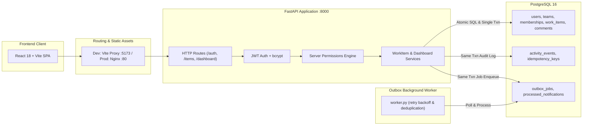

# OpsFlow — Operations Under Pressure

OpsFlow is an internal operations management platform designed to create, assign, track, approve, and resolve high-stakes operational work items across teams. It was built for the Newtonite Software Engineering Challenge with a focus on concurrency correctness, server-enforced role authorization, transactional event logging, and reliable asynchronous processing.

**Author:** Muskan Kumari — Galgotias University  
**Repository:** [github.com/muskan-773/opsflow](https://github.com/muskan-773/opsflow)  

---

## What It Does

OpsFlow manages operational tasks across teams (incidents, customer escalations, payment discrepancies, compliance reviews) through a strictly controlled state machine:
`Open -> In Progress -> Awaiting Approval -> Resolved -> Closed`.

The backend enforces tenant and role-based permissions on every mutation, writes an append-only activity trail in the same transaction as the change, handles race conditions with atomic conditional SQL and optimistic locking, and dispatches background notifications through a transactional outbox worker.

---

## Architecture Overview



**Transactional Guarantees:** Every mutating operation (creation, assignment, claim, transition) writes the item update, the activity log, and the outbox notification job **in the exact same database transaction**. Either all three succeed, or all three roll back.

---

## Tech Stack

| Layer | Technology | Rationale |
|-------|------------|-----------|
| Backend | Python 3.12+ · FastAPI · SQLAlchemy 2.0 | High performance, typed request/response schemas via Pydantic, explicit session handling |
| Database | PostgreSQL 16+ | ACID transactions, row-level locks, composite B-tree indexes |
| Database Driver | psycopg 3 (`psycopg[binary]`) | Modern binary PostgreSQL client for Python |
| Authentication | JWT (python-jose) + bcrypt | Stateless bearer tokens, salted password hashing |
| Async Worker | Python background runner (`worker.py`) | Transactional Outbox processor with exponential backoff |
| Frontend | React 18 · Vite · React Router v6 | Fast HMR, optimistic state reconciliation, clean modular CSS |
| Testing | pytest · FastAPI TestClient | Comprehensive API integration and concurrency test suite |
| Containerization | Docker Compose · Nginx | One-command setup for database, backend, worker, and frontend |

---

## Prerequisites

- **Python 3.12+**
- **Node.js 18+** and npm
- **PostgreSQL 14+** (local instance or via Docker)

---

## Quick Start (Docker Compose — One Command)

The easiest way to run the entire stack (PostgreSQL, backend API, outbox worker, and frontend web app) is via Docker Compose:

```bash
docker compose up --build
```

- Web UI: `http://localhost`
- API documentation (Swagger): `http://localhost:8000/docs`
- Health check: `http://localhost:8000/health`

---

## Local Development Setup (Without Docker)

### 1. Database Setup
Connect to your local PostgreSQL instance and create the application and test databases:

```bash
psql -U postgres -c "CREATE USER opsflow WITH PASSWORD 'opsflowdev';"
psql -U postgres -c "CREATE DATABASE opsflow OWNER opsflow;"
psql -U postgres -c "CREATE DATABASE opsflow_test OWNER opsflow;"
```

### 2. Backend API & Outbox Worker

```bash
cd backend
python3 -m venv .venv
source .venv/bin/activate    # On Windows: .venv\Scripts\activate
pip install -r requirements.txt

# Seed the database with teams, demo accounts, and sample work items
python seed.py

# Start the FastAPI server
uvicorn app.main:app --reload --port 8000
```

In a separate terminal, start the asynchronous outbox worker:

```bash
cd backend
source .venv/bin/activate
python worker.py --interval 2
```

### 3. Frontend Web Client

```bash
cd frontend
npm install
npm run dev
```

Open `http://localhost:5173` in your browser. The Vite dev server proxies API calls (`/auth`, `/items`, `/dashboard`) directly to port 8000.

---

## Demo Credentials

The seed script creates accounts across roles and teams. All passwords are encrypted with bcrypt:

| Role | Team | Email | Password | Permissions & Notes |
|------|------|-------|----------|---------------------|
| Global Admin | All Teams | `admin@opsflow.demo` | `admin123` | Full superuser access across all teams |
| Lead | Operations | `lead.ops@opsflow.demo` | `lead123` | Can approve, reassign, and transition any item in Operations |
| Lead | Payments | `lead.pay@opsflow.demo` | `lead123` | Lead for Payments team items |
| Lead | Customer Support | `lead.sup@opsflow.demo` | `lead123` | Lead for Support team items |
| Member | Operations | `member.ops@opsflow.demo` | `member123` | Can create items, claim unassigned tasks, and edit own items |
| Member | Payments | `member.pay@opsflow.demo` | `member123` | Standard team member in Payments |
| Member | Support + Ops | `member.sup@opsflow.demo` | `member123` | Belongs to two teams simultaneously |
| Viewer | Operations | `viewer.ops@opsflow.demo` | `viewer123` | Read-only access to Operations items |

The login screen includes quick-fill buttons for testing different role permissions.

---

## Running the Automated Test Suite

All tests run against an isolated `opsflow_test` database. Each test executes inside a database transaction that rolls back upon completion, guaranteeing complete test isolation without slow database teardowns:

```bash
cd backend
source .venv/bin/activate
pytest -v
```

### Test Coverage Highlights

- **`test_concurrency.py`**: Runs concurrent task claims using real parallel threads against PostgreSQL. Verifies that only one thread succeeds while the other receives `HTTP 409 Conflict`.
- **`test_optimistic_lock.py`**: Verifies that submitting an edit with a stale `version` is rejected with `HTTP 409 Conflict` and leaves row data untouched.
- **`test_idempotency.py`**: Confirms that submitting repeated requests with the same `Idempotency-Key` returns the cached response without creating duplicate items.
- **`test_workflow.py`**: Verifies valid state progression, rejects invalid jumps (e.g. `open -> closed`), verifies that non-lead approval attempts return `403 Forbidden`, and ensures Lead approvals succeed.
- **`test_authz.py`**: Tests team scoping: users outside a team receive `403 Forbidden` on read, create, and transition attempts.
- **`test_outbox.py`**: Verifies that mutating actions enqueue outbox jobs in the same transaction, that duplicate job processing yields exactly one notification (consumer idempotency), and that failed jobs retry with backoff before marking failed.
- **`test_dashboard.py`**: Validates server-side metric aggregations and tenant scoping for the "needs attention" dashboard views.

---

## The Seven Critical Engineering Behaviors

1. **Atomic Claiming**: Uses `UPDATE work_items SET assignee_id = :uid WHERE id = :id AND assignee_id IS NULL`. When two users race to claim an item, database row locks guarantee exactly one update succeeds.
2. **Optimistic Locking**: Work items track an integer `version`. Updates execute conditionally `WHERE id = :id AND version = :version`. Conflicting concurrent edits receive `HTTP 409 Conflict` with the latest version.
3. **Idempotency Keys**: `POST /items` accepts an `Idempotency-Key` header. Responses are persisted in the transaction; subsequent retries replay the stored response.
4. **Server-Enforced Authorization**: Centralized in `app/permissions.py`. Every request validates team tenancy and role permissions on the server before modifying state.
5. **Workflow State Machine**: Allowed transitions are mapped on the server. The approval step (`awaiting_approval -> resolved`) is restricted to team Leads and Admins.
6. **Transactional Outbox & Worker**: Event jobs are written inside the transaction modifying the item. The background worker retries transient failures with exponential backoff and caps attempts at 3.
7. **Optimistic UI Reconciliation**: The frontend optimistically reflects state changes instantly. If the server returns 409 Conflict or 403 Forbidden, the UI automatically rolls back to the prior state snapshot and displays the conflict explanation.

---

## Known Limitations

- **No Public Sign-Up**: User accounts and team memberships are seeded. In an internal enterprise system, user provisioning is typically managed via directory services (LDAP/SCIM).
- **Outbox Email Delivery**: Outbox events simulate dispatching notifications into `processed_notifications` rather than connecting to a live third-party SMTP server (SendGrid/AWS SES).
- **Token Expiration**: Access tokens are valid for 8 hours without a refresh token rotation flow.
- **Search Mechanism**: Work item filtering uses SQL `ILIKE` across title and description with an index on `created_at`. At 10x scale, this would be upgraded to PostgreSQL full-text search (`tsvector` + GIN index).

---

## Next Steps (With Another Week)

1. Implement PostgreSQL `tsvector` full-text search with query ranking.
2. Add PostgreSQL `LISTEN / NOTIFY` to wake the outbox worker immediately on job insertion instead of polling.
3. Introduce refresh token rotation with token revoking.
4. Build a team-member user picker dropdown for assignment modals.
5. Partition the `activity_events` and `outbox_jobs` tables by calendar month.
